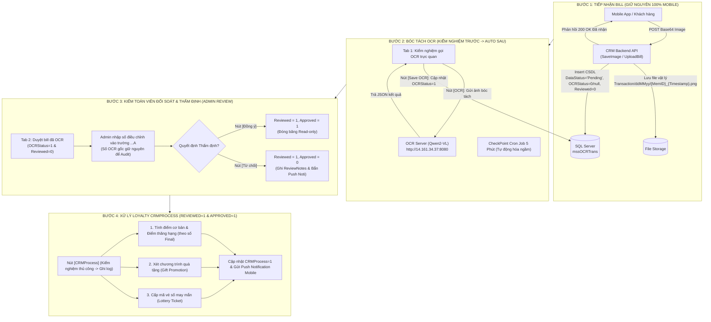

# TÀI LIỆU KỸ THUẬT TỔNG THỂ DỰ ÁN CRMMALL (TECHNICAL MASTER CATALOG)
## HỆ THỐNG ĐỐI SOÁT & XỬ LÝ HÓA ĐƠN TÍCH ĐIỂM TTTM GIGAMALL (.NET 8 CORE)

> 🏢 **Hệ sinh thái**: CRM Loyalty Gigamall - Sao Mai Solution  
> 🎯 **Mục tiêu**: Hiện đại hóa phân hệ bóc tách hóa đơn OCR từ ứng dụng WinForms cũ (.NET Framework 4.5.2) sang nền tảng Web .NET 8 LTS kết hợp AI VLM tự động hóa và tích hợp nền tảng Loyalty Core.  
> 📌 **Tài liệu này là**: **Sơ đồ danh mục tổng thể (Master Catalog)** định vị toàn bộ kiến trúc dự án, đóng vai trò bản đồ chỉ dẫn đến các tài liệu chuyên đề chi tiết.

---

## 🏛️ THƯ MỤC DỰ ÁN THAM KHẢO (REFERENCE REPOSITORY)

Khi cần tra cứu, nghiên cứu hoặc đối soát mã nguồn nghiệp vụ cũ, toàn bộ hệ thống cũ được lưu trữ tại:
* **Đường dẫn thư mục**: `D:\GIT PROJECT\CRM SAOMAI\CRMPROFILELogic\SourceCode\CRMProfileManagement`
* **Các tệp mã nguồn tham khảo trọng yếu**:
  1. `OCRBillProcess/frmOCRBillReview.cs`: Màn hình giao diện WinForms đối soát cũ (Logic controls, xem ảnh, nút duyệt/từ chối).
  2. `CRMProfileManagement/OCRBillPROCESS/GigaBillProcess.cs`: **[QUAN TRỌNG NHẤT]** Toàn bộ nghiệp vụ thẩm định (`BillReview`), chống trùng hóa đơn, tính điểm thưởng/hạng, xét quà tặng (`GetPromCode`), và quay số (`LotteryProgramUI`).
  3. `MSA/MSAEntity/mssOCRTran.cs`: Thực thể Entity Framework 6 đại diện cho bảng `mssOCRTrans`.
  4. `CRMBase/OCRBillPROCESS/BillProcess.cs`: Thuật toán bóc tách và phân tích mẫu hóa đơn theo cấu hình cũ.

---

## 🧭 BẢN ĐỒ DANH MỤC TÀI LIỆU CHI TIẾT (DOCUMENTATION CATALOG)

Mỗi tài liệu chuyên đề chi tiết trong thư mục `docs/` đều được cấu trúc chuẩn hóa thành 2 phần:
* **Phần 1: Hiện trạng hệ thống cũ (As-Is / Legacy Analysis)**: Mã nguồn cũ, cách thức hoạt động, hạn chế và nút thắt.
* **Phần 2: Thiết kế hệ thống mới (To-Be / Modern Specification)**: Kiến trúc mới trên .NET 8, contracts, schema và tiêu chuẩn nghiệm thu.

| STT | Tài liệu chuyên đề chi tiết | Phạm vi nghiệp vụ & Nội dung chính | Đường dẫn liên kết |
| :---: | :--- | :--- | :--- |
| **01** | **Database Schema Migration** | Chi tiết bảng `mssOCRTrans`, ý nghĩa 4 cờ status (`OCRStatus`, `Reviewed`, `Approved`, `CRMProcess`), nhóm trường điều chỉnh `...A` và liên kết `mssCardTrans`. | [01_DATABASE_SCHEMA_MIGRATION.md](file:///d:/GIT%20PROJECT/GIGAMallMigration/docs/01_DATABASE_SCHEMA_MIGRATION.md) |
| **02** | **Bill Ingestion & Storage** | Bước 1: Tiếp nhận upload bill từ Mobile App qua Base64, quy chuẩn đặt tên file `Transaction/ddMMyy`, lưu trữ và phục vụ ảnh. | [02_BILL_INGESTION_AND_STORAGE.md](file:///d:/GIT%20PROJECT/GIGAMallMigration/docs/02_BILL_INGESTION_AND_STORAGE.md) |
| **03** | **OCR AI Integration** | Bước 2: Bóc tách hóa đơn qua AI Server độc lập (Qwen2-VL tại `http://14.161.34.37:8080`), `OcrApiClient`, DTOs và lưu `OCRStatus = 1`. | [03_OCR_AI_INTEGRATION.md](file:///d:/GIT%20PROJECT/GIGAMallMigration/docs/03_OCR_AI_INTEGRATION.md) |
| **04** | **Admin Review Console** | Bước 3: Màn hình đối soát Web 2 Tab, Header bộ lọc chung, Modal xem ảnh có Zoom/Pan/Rotate, 2 vùng AI vs Adjust `...A`, nút Duyệt/Từ chối. | [04_ADMIN_REVIEW_CONSOLE.md](file:///d:/GIT%20PROJECT/GIGAMallMigration/docs/04_ADMIN_REVIEW_CONSOLE.md) |
| **05** | **Loyalty CRMProcess Engine** | Bước 4: Xử lý chuỗi nghiệp vụ Loyalty (Tích điểm cơ bản/hạng, xét Gift Promotion, cấp vé số Lottery) & ghi log chi tiết. | [05_LOYALTY_CRMPROCESS_ENGINE.md](file:///d:/GIT%20PROJECT/GIGAMallMigration/docs/05_LOYALTY_CRMPROCESS_ENGINE.md) |
| **06** | **Background Automation** | Bước 2.2: Đóng gói Worker / CheckPoint Framework Cron Job quét tự động ngầm định kỳ 5 phút. | [06_BACKGROUND_AUTOMATION.md](file:///d:/GIT%20PROJECT/GIGAMallMigration/docs/06_BACKGROUND_AUTOMATION.md) |

---

## 🔄 TỔNG QUAN CHU TRÌNH 4 BƯỚC (END-TO-END WORKFLOW)

---

## ⚡ CÁC NGUYÊN TẮC NGHIỆP VỤ BẤT BIẾN (GOLDEN GOVERNANCE RULES)

1. **Nguyên tắc Phê duyệt trước (Rule 1)**: Luôn lập dev plan cho việc thực hiện, **CHỈ THỰC HIỆN KHI NHẬN ĐƯỢC LỆNH OK TỪ USER**.
2. **Nguyên tắc Số Final (Rule 2)**:
   - Các trường do Admin nhập có tiếp vị ngữ `...A` (`BillNumberA`, `BillTotalA`, `OutletNumberA`, `BrandNumberA`, `BillDateTimeA`) luôn là **FINAL**.
   - Mọi nghiệp vụ tính điểm, thăng hạng, quà tặng, vé số bắt buộc dùng số Final.
   - *Ví dụ*: `BillTotal = 600,000` nhưng `BillTotalA = 1,000,000` $\rightarrow$ Số tính điểm = `1,000,000`. Nếu Admin không sửa thì lấy số OCR.
3. **Nguyên tắc Audit bất biến (Rule 3)**:
   - Dữ liệu OCR AI và dữ liệu Admin điều chỉnh (`...A`) độc lập hoàn toàn trong CSDL, tuyệt đối không được ghi đè lên nhau.
4. **Nguyên tắc Đóng băng sau duyệt (Rule 4)**:
   - Khi hóa đơn đã được duyệt (`Reviewed = 1` hoặc `ReviewStatus = 1`), toàn bộ thông tin bill chuyển sang trạng thái Read-only, không thể chỉnh sửa.
5. **Vòng đời 4 cờ trạng thái (Rule 5)**:
   - `OCRStatus`: `0/null` (Chưa OCR) $\rightarrow$ `1` (Đã OCR thành công).
   - `Reviewed` / `ReviewStatus`: `0` (Chờ review) $\rightarrow$ `1` (Đã review).
   - `Approved`: `null` (Chờ quyết định) $\rightarrow$ `1` (Đồng ý) hoặc `0` (Từ chối).
   - `CRMProcess`: `0/null` (Chưa chạy loyalty) $\rightarrow$ `1` (Đã tính điểm, quà, vé số).
