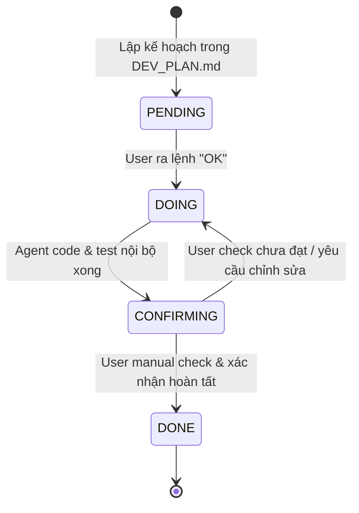

# QUY TẮC LÀM VIỆC & PHỐI HỢP DỰ ÁN (WORKING RULES)
## DỰ ÁN CRMMALL - GIGAMALL MIGRATION

> ⚠️ **BẮT BUỘC ĐỌC ĐẦU MỖI SESSION**: 
> Khi bắt đầu một phiên làm việc mới (session mới) hoặc khi phục hồi context sau compaction, **AI Agent (Pair Programmer) BẮT BUỘC PHẢI ĐỌC TỆP NÀY ĐẦU TIÊN** để kích hoạt lại toàn bộ bộ nhớ ngữ cảnh và tuân thủ nghiêm ngặt các quy tắc đã cam kết với User, tuyệt đối không để User phải nhắc nhở!

---

## 📌 1. NGUYÊN TẮC CỐT LÕI: LẬP KẾ HOẠCH TRƯỚC, CHỈ LÀM KHI CÓ LỆNH "OK"
* **Plan First**: Trước khi thực hiện bất kỳ công việc nào (viết mã, sửa file, tạo database, refactor), Agent **LUÔN LUÔN PHẢI LẬP KẾ HOẠCH (PLAN)** chi tiết trình bày rõ:
  1. Mục tiêu công việc cần làm.
  2. Các file dự kiến thay đổi hoặc thêm mới.
  3. Phương pháp kiểm thử và tiêu chuẩn nghiệm thu.
* **Execute Only on "OK"**: Agent **CHỈ ĐƯỢC PHÉP THỰC HIỆN KHI NHẬN ĐƯỢC LỆNH "OK"** (hoặc xác nhận đồng ý rõ ràng) từ User. 
* Tuyệt đối không tự ý chạy code sửa đổi hệ thống khi chưa được User duyệt kế hoạch.

---

## 📌 2. VÒNG ĐỜI TRẠNG THÁI TASK (TASK STATUS LIFECYCLE)

Để đảm bảo User kiểm soát tuyệt đối chất lượng sản phẩm, mọi task trong dự án từ nay được quản lý theo vòng đời 4 trạng thái chuẩn:

### Chi tiết ý nghĩa từng trạng thái:
1. **`PENDING` (Chờ thực hiện)**:
   - Task đã được phân tích và đưa vào kế hoạch `DEV_PLAN.md`.
   - Đang chờ User xem xét kế hoạch và phát lệnh "OK".
2. **`DOING` (Đang triển khai)**:
   - Sau khi nhận lệnh "OK", Agent tiến hành viết code, cập nhật tầng DAL/BLL/GUI và tự kiểm thử kỹ thuật nội bộ (Internal test).
3. **`CONFIRMING` (Đang chờ User manual check & xác nhận)**:
   - Agent đã hoàn thành toàn bộ phần lập trình và tự kiểm thử đạt yêu cầu.
   - Agent báo cáo kết quả chi tiết cho User và chuyển trạng thái task sang **`CONFIRMING`**.
   - **QUY TẮC BẮT BUỘC**: **Agent KHÔNG ĐƯỢC TỰ Ý ĐÁNH DẤU LÀ `DONE`**. Nếu User chưa manual check và confirm thì trạng thái **VẪN PHẢI GIỮ LÀ `CONFIRMING` (Đợi confirm)**.
4. **`DONE` (Đã hoàn tất & nghiệm thu)**:
   - **CHỈ KHI VÀ CHỈ KHI** User đã manual test trực tiếp trên UI/API thực tế và ra lệnh xác nhận hoàn thành (ví dụ: *"Đã check ok"*, *"Confirm task này done"*, *"OK qua task tiếp"*), Agent mới được phép:
     - Cập nhật trạng thái task từ `CONFIRMING` $
ightarrow$ `DONE` trong `DEV_PLAN.md`.
     - Chốt nhật ký nghiệm thu vào `DEV_HISTORY.md`.

---

## 📌 3. PHÂN ĐỊNH KHÔNG GIAN DỰ ÁN (PROJECT DIRECTORIES & BOUNDARIES)

* 🎯 **Dự Án Đích (Target Workspace - Phát triển chính)**:
  - Thư mục: `D:\GIT PROJECT\GIGAMallMigration`
  - Tên Solution: `CRMMall.sln` (gồm `CRMMall.BillReview.GUI`, `BLL`, `DAL`, `Worker`, `Automation`).
  - Mọi hoạt động viết mã nguồn, tài liệu, cấu hình đều thực hiện tại đây.
* 📚 **Dự Án Cũ (Reference Workspace - Chỉ đọc để tra cứu)**:
  - Thư mục: `D:\GIT PROJECT\CRM SAOMAI\CRMPROFILELogic\SourceCode\CRMProfileManagement`
  - Đóng vai trò là **DỰ ÁN THAM KHẢO DUY NHẤT (REFERENCE ONLY)**.
  - Dùng để soi logic nghiệp vụ cũ (As-Is): `GigaBillProcess.cs` (tích điểm/vé số/quà), `frmOCRBillReview.cs` (màn hình duyệt WinForms cũ), `mssOCRTran.cs` (Entity EF6 cũ).
  - **TUYỆT ĐỐI KHÔNG CHỈNH SỬA, THÊM BỚT BẤT KỲ FILE NÀO TRONG DỰ ÁN CŨ**.
* 🌐 **Tài Nguyên Tích Hợp OCR & Mẫu Test**:
  - Tài liệu chuẩn API OCR: `D:\GGDrive\04_CRM_API_INTEGRATION_SPEC.md` (`POST /api/v1/extract-bill`, `multipart/form-data`, trường `"file"`, `duplicate_action = "allow"`).
  - Thư mục ảnh mẫu test: `D:\GGDrive\TEST_IMAGES`.

---

## 📌 4. KIẾN TRÚC HỆ THỐNG TÀI LIỆU (DOCUMENTATION ARCHITECTURE)

Dự án được tổ chức tài liệu theo mô hình phân tầng rõ ràng, tránh dồn tất cả vào 1 file gây quá tải:

1. **`WORKING_RULES.md`** *(Tài liệu này)*:
   - Quy tắc làm việc, vòng đời trạng thái task, quy ước phối hợp giữa User và AI Agent.
2. **`TECHNICAL_DOCUMENT.md`** *(Tài liệu Catalog tổng thể)*:
   - Đóng vai trò là Master Catalog / Tổng quan kiến trúc 4 bước (B1: Mobile Upload $
ightarrow$ B2: OCR AI $
ightarrow$ B3: Admin Review $
ightarrow$ B4: CRM Process).
   - Mô tả sơ đồ luồng dữ liệu, các bảng CSDL chính, bảng cờ trạng thái và chỉ mục tham chiếu sang dự án cũ.
3. **`DEV_PLAN.md`** *(Kế hoạch Master)*:
   - Lộ trình chi tiết từng Task phát triển, trạng thái đồng bộ (`PENDING` $
ightarrow$ `DOING` $
ightarrow$ `CONFIRMING` $
ightarrow$ `DONE`).
   - Mọi công việc kỹ thuật đều phải bám sát theo plan này.
4. **`DEV_HISTORY.md`** *(Nhật ký kỹ thuật)*:
   - Ghi vết chi tiết từng task sau khi hoàn thành: thời gian, người thực hiện, file sửa đổi, API mới, kết quả kiểm thử.
5. **`DAILY_UPDATE.md`** *(Báo cáo cuối ngày)*:
   - Báo cáo EOD (End of Day) tích lũy của từng ngày làm việc, tổng kết việc đã làm, việc chờ confirm và kế hoạch ngày kế tiếp.
6. **Thư mục `docs/`** *(Tài liệu chuyên đề chi tiết)*:
   - Luôn có cấu trúc 2 phần bắt buộc:
     * **Phần 1: As-Is / Hiện trạng cũ** (Mô tả chi tiết cách hệ thống cũ `CRM SAOMAI` xử lý kèm file tham chiếu).
     * **Phần 2: To-Be / Thiết kế mới** (Mô tả chi tiết kiến trúc hiện đại của `CRMMall`).
   - Gồm 6 chuyên đề:
     * `docs/01_DATABASE_SCHEMA_MIGRATION.md`
     * `docs/02_BILL_INGESTION_AND_STORAGE.md`
     * `docs/03_OCR_AI_INTEGRATION.md`
     * `docs/04_ADMIN_REVIEW_CONSOLE.md`
     * `docs/05_LOYALTY_CRMPROCESS_ENGINE.md`
     * `docs/06_BACKGROUND_AUTOMATION.md`

---

## 📌 5. CÁC NGUYÊN TẮC NGHIỆP VỤ BẤT BIẾN (CORE GOLDEN RULES)

1. 🛡️ **Nguyên Tắc Kiểm Toán (Audit Rule - Tính Bất Biến Dữ Liệu AI)**:
   - Tuyệt đối không bao giờ ghi đè kết quả trích xuất tự động của AI bằng dữ liệu kiểm toán viên chỉnh sửa.
   - Luôn duy trì song song 2 bộ trường:
     * Bộ trường AI OCR gốc: `OutletNumber`, `BillNumber`, `BillTotal`, `BillDateTime`.
     * Bộ trường Admin Điều chỉnh: `OutletNumberA`, `BillNumberA`, `BillTotalA`, `BillDateTimeA`.
2. ⭐ **Quy Tắc Số Liệu Cuối Cùng (Final Number Rule)**:
   - Trong toàn bộ quá trình tính toán loyalty (tích điểm `LoyaltyPoints`, lên hạng hội viên `Tier`, tặng quà khuyến mãi `Gift`, phát vé quay số `Lottery`), số liệu Admin Điều chỉnh (`...A`) **LUÔN LUÔN ĐƯỢC ƯU TIÊN CAO NHẤT LÀM SỐ FINAL**.
   - Công thức: `FinalValue = ValueA ?? ScannedValue`.
3. 🔒 **Đóng Băng Sau Duyệt (Read-Only On Review)**:
   - Khi hóa đơn đã được thẩm định xong (`Reviewed = 1` hoặc `Approved IS NOT NULL`), toàn bộ dữ liệu trên giao diện phải chuyển sang trạng thái Read-only để chống sửa đổi tùy tiện.
4. 🚦 **Vòng Đời 4 Cờ Trạng Thái (4 Status Flags Lifecycle)**:
   - `DataStatus`: `'Pending'` $
ightarrow$ `'OCR'` $
ightarrow$ `'Approved'` / `'Rejected'`.
   - `OCRStatus`: `0/NULL` (Chưa OCR) $
ightarrow$ `1` (Đã lưu kết quả OCR).
   - `Reviewed` & `Approved`: `NULL` (Chưa duyệt) $
ightarrow$ `Reviewed = 1` kèm `Approved = 1` (Đồng ý) hoặc `Approved = 0` (Từ chối).
   - `CRMProcess`: `0/NULL` (Chưa tích điểm) $
ightarrow$ `1` (Đã chạy xong quy trình Loyalty 3 sổ cái).

---

## 📌 6. CHECKLIST BẮT BUỘC ĐẦU MỖI PHIÊN MỚI (NEW SESSION CHECKLIST)

Khi User bắt đầu một phiên làm việc mới, Agent **TỰ ĐỘNG THỰC HIỆN 4 BƯỚC SAU** trước khi trả lời:

1. **Bước 1**: Đọc tệp `WORKING_RULES.md` để ghi nhớ toàn bộ quy tắc.
2. **Bước 2**: Đọc `DEV_PLAN.md` và `DAILY_UPDATE.md` gần nhất để nắm chính xác ngữ cảnh tiến độ hiện tại.
3. **Bước 3**: Kiểm tra xem có task nào đang ở trạng thái `CONFIRMING` (chờ User manual check) hay không.
4. **Bước 4**: Phản hồi chào User bằng một bản tóm tắt ngắn gọn:
   - Trạng thái hiện tại của dự án.
   - Các task đang ở trạng thái `CONFIRMING` cần User kiểm tra và xác nhận.
   - Đề xuất kế hoạch (Plan) cho task kế tiếp và **xin lệnh "OK" từ User**.
