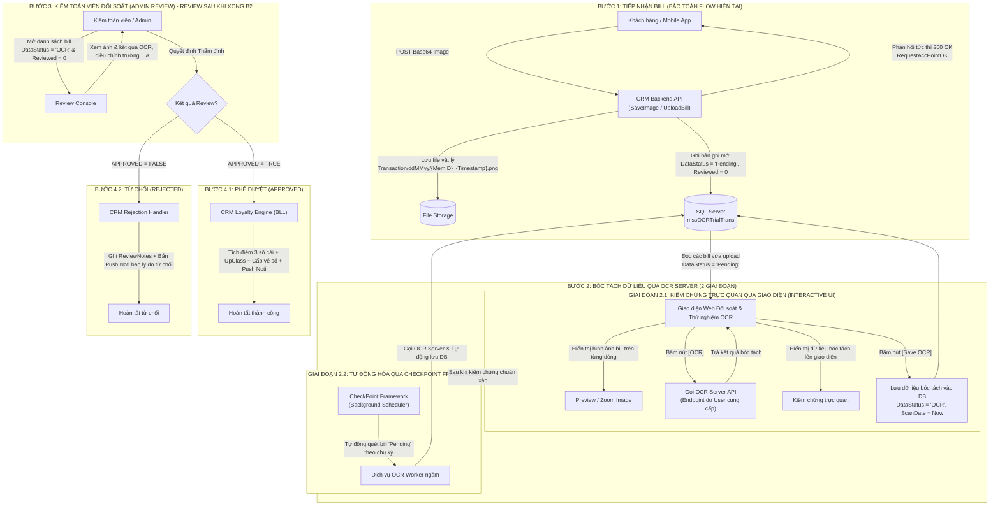

# ĐẶC TẢ CHU TRÌNH SỐNG HÓA ĐƠN OCR (B1 -> B4) & KẾ HOẠCH TRIỂN KHAI CHI TIẾT (DEV PLAN)
## (OCR BILL LIFECYCLE SPECIFICATION & STEP-BY-STEP DEV PLAN)

> 🏢 **Hệ sinh thái**: CRM Loyalty Gigamall - Sao Mai Solution  
> 🎯 **Mục tiêu**: Chuẩn hóa toàn bộ chu trình sống của hóa đơn từ khi khách hàng chụp ảnh gửi lên Mobile App (B1), đưa sang máy chủ OCR chuyên dụng bóc tách (B2), kiểm toán viên đối soát thẩm định (B3), đến khi xử lý kết quả Phê duyệt tích điểm / thăng hạng / cấp vé số (B4.1) hoặc Từ chối phản hồi lý do (B4.2).  
> 📌 **Nguyên tắc điều hành & triển khai**:
> 1. **Bảo toàn 100% luồng tiếp nhận hiện tại (B1)**: Không thay đổi hợp đồng API tiếp nhận để Mobile App ngoài Production hoạt động liên tục, không bị ảnh hưởng.
> 2. **Tách đôi Bước 2 (Kiểm chứng trước - Tự động hóa sau)**:
>    - **Giai đoạn 2.1**: Xây dựng UI trực quan hiển thị ảnh bill vừa upload, có nút **[OCR]** gọi bóc tách và nút **[Save OCR]** lưu CSDL để kiểm chứng độ chính xác bằng mắt và thao tác thực tế.
>    - **Giai đoạn 2.2**: Sau khi Giai đoạn 2.1 đã được kiểm chứng chuẩn xác, tiến hành đóng gói tự động hóa quét ngầm qua **CheckPoint Framework** (User sẽ cung cấp tài liệu chi tiết sau).
> 3. **Phê duyệt cuốn chiếu**: Triển khai và nghiệm thu dứt điểm từng Objective của Bước 2. Các Objective của Bước 3 và Bước 4 sẽ được review và thống nhất chi tiết sau khi hoàn thành xong Bước 2.

---

> ✅ **TRẠNG THÁI KẾ HOẠCH (DEV PLAN STATUS)**: **ĐÃ ĐƯỢC USER PHÊ DUYỆT CHÍNH THỨC (APPROVED)**  
> 📅 **Thời điểm phê duyệt**: 24/10/2026 10:40 (GMT+7)  
> 🚀 **Mục tiêu đang kích hoạt triển khai (ACTIVE)**: **GIAI ĐOẠN 2.1 - GIAO DIỆN KIỂM CHỨNG TRỰC QUAN & THỬ NGHIỆM GỌI OCR (INTERACTIVE TESTING UI)**  
> 🎯 **Trình tự thực thi**: Obj 2.1.1 ➔ Obj 2.1.2 ➔ Obj 2.1.3 ➔ Obj 2.1.4 (User Nghiệm thu 2.1) ➔ Chuyển tiếp Giai đoạn 2.2 (CheckPoint Framework).

---

### 📊 BẢNG THEO DÕI TIẾN ĐỘ THỰC HIỆN CHI TIẾT (PROGRESS TRACKING MATRIX)

| Mã Mục tiêu | Nội dung Công việc & Phạm vi kỹ thuật | Trạng thái | Người duyệt / Ghi chú |
| :--- | :--- | :---: | :--- |
| **BƯỚC 1 (AS-IS)** | Bảo toàn 100% flow tiếp nhận hiện tại qua API `SaveImage` / `UploadBill`, lưu file `Transaction/ddMMyy` và tạo bản ghi `mssOCRTrialTrans` ('Pending') | <span style="color:green;font-weight:bold;">ĐÃ DUYỆT (HOÀN TẤT)</span> | Giữ nguyên vẹn, không làm gián đoạn Mobile App |
| **Obj 2.1.1** | Xây dựng `OcrApiClient` & DTO kết nối OCR Server `http://14.161.34.37:8080` (FastAPI / Qwen2-VL) | <span style="color:green;font-weight:bold;">HOÀN THÀNH</span> | `CRMMall.BillReview.BLL` (Polling, Async upload, Error resilience) |
| **Obj 2.1.2** | Viết API `GET /api/bills/pending-upload`, `/image`, `/ocr`, `/save-ocr` | <span style="color:green;font-weight:bold;">HOÀN THÀNH</span> | DAL `IBillRepository` & GUI `BillsController` |
| **Obj 2.1.3** | Dựng Giao diện Web Interactive OCR Testing UI (ảnh trên từng dòng, nút [OCR], nút [Save OCR], Lightbox zoom/rotate) | <span style="color:green;font-weight:bold;">HOÀN THÀNH</span> | `CRMMall.BillReview.GUI\wwwroot\index.html` |
| **Obj 2.1.4** | Thử nghiệm thực tế toàn trình: Nạp 5 bill mẫu ➔ Xem ảnh ➔ Bấm [OCR] ➔ Bấm [Save OCR] ➔ Nghiệm thu | 🚀 **SẴN SÀNG NGHIỆM THU** | Đã kiểm thử E2E & Browser tự động 100% thành công |
| **Giai đoạn 2.2** | Tự động hóa quét ngầm và gọi OCR qua mô hình **CheckPoint Framework** | 📋 Chờ tài liệu | Triển khai sau khi User nghiệm thu Giai đoạn 2.1 |
| **Bước 3 (Review)**| API & Giao diện Review đối soát thẩm định của kiểm toán viên | 📋 Chờ review | Thảo luận chi tiết sau khi xong Bước 2 |
| **Bước 4 (Loyalty)**| Xử lý chuỗi nghiệp vụ khi Phê duyệt (4.1) hoặc Từ chối (4.2) | 📋 Chờ review | Thảo luận chi tiết sau khi xong Bước 2 |


---

## PHẦN 1: TỔNG QUAN LUỒNG NGHIỆP VỤ (EXECUTIVE WORKFLOW SUMMARY)

Chu trình xử lý hóa đơn OCR được cấu trúc thành các chặng mạch lạc:



---

## PHẦN 2: ĐẶC TẢ CHI TIẾT BƯỚC B1 - TIẾP NHẬN HÓA ĐƠN HIỆN TẠI (AS-IS SPECIFICATION)

> ⚠️ **Yêu cầu bắt buộc**: Giữ nguyên vẹn 100% cơ chế tiếp nhận hiện tại để Mobile App ngoài Production không bị ảnh hưởng.

### 2.1. Danh mục API tiếp nhận hiện tại

Hệ thống hiện có 2 API tiếp nhận hóa đơn tương đương nhau (phục vụ ứng dụng Gigamall và Core Mobile):

| Thuộc tính | Kênh 1 (Chính thức GiGa) | Kênh 2 (Core Mobile Trans) |
| :--- | :--- | :--- |
| **Project** | `CRMAPI` | `CoreAPI` |
| **Controller** | `MobOCRController.cs` | `MobTransController.cs` |
| **Route Prefix**| `[RoutePrefix("GiGa/Mob/OCR")]` | `[RoutePrefix("api/Mob/Trans")]` |
| **Endpoint URL**| `POST /GiGa/Mob/OCR/SaveImage` | `POST /api/Mob/Trans/UploadBill` |
| **HTTP Method** | `POST` | `POST` |
| **Content-Type**| `application/json` | `application/json` |
| **Xác thực** | Kiểm tra Token di động qua `BaseMobileTracking.IsValidToken(model.MemID, model.TokenInfo)` |

### 2.2. Đặc tả DTO Request (`IOCRInput`)

Dữ liệu JSON gửi lên từ ứng dụng di động:

```json
{
  "AppName": "GiGa",
  "Language": "VN",
  "MemID": "0901234567",
  "Type": 0,
  "BrandNumber": "",
  "OutletNumber": "",
  "ImageBase64": "/9j/4AAQSkZJRgABAQEAYABgAAD/2wBDAAgGBgcGBQgHBwcJCQgKDBQNDAsLDBkSEw8UHRofHh0aHBwgJC4nICIsIxwcKDcpLDAxNDQ0Hyc5PTgyPC4zNDL/...",
  "TokenInfo": {
    "Token": "d41d8cd98f00b204e9800998ecf8427e",
    "SecretKey": "..."
  }
}
```

#### Bảng ý nghĩa các trường Input:

| Tên trường | Kiểu dữ liệu | Bắt buộc | Ý nghĩa & Quy tắc nghiệp vụ |
| :--- | :---: | :---: | :--- |
| `AppName` | `string` | Có | Tên ứng dụng gửi request (`"GiGa"`, `"MSA"`). Mặc định là `"GiGa"`. |
| `Language` | `string` | Có | Ngôn ngữ thông điệp trả về (`"VN"` hoặc `"EN"`). Mặc định `"VN"`. |
| `MemID` | `string` | **Bắt buộc** | Mã định danh duy nhất của hội viên (thường là số điện thoại hoặc mã tài khoản CRM). Nếu thiếu -> trả lỗi `MisMemID`. |
| `TokenInfo` | `object` | **Bắt buộc** | Gói bảo mật phiên đăng nhập (`Token`, `SecretKey`). API kiểm tra tính hợp lệ trước khi cho phép upload. |
| `Type` | `int` (Enum) | Có | `0` = `Transaction` (Hóa đơn mua sắm của khách); `1` = `Config` (Ảnh mẫu cấu hình cửa hàng). Ở luồng này giá trị luôn là `0`. |
| `BrandNumber` | `string` | Không | Mã thương hiệu (nếu khách chọn trước trên app, thông thường bỏ trống để OCR tự nhận diện). |
| `OutletNumber` | `string` | Không | Mã gian hàng (nếu khách chọn trước trên app, thông thường bỏ trống để OCR tự nhận diện). |
| `ImageBase64` | `string` | **Bắt buộc** | Chuỗi nhị phân Base64 đại diện cho file ảnh hóa đơn chụp từ camera. Nếu rỗng -> trả lỗi `MisImageBase64`. |

### 2.3. Quy chuẩn Đặt tên & Lưu trữ File ảnh (Naming Convention & Storage)

Thực hiện trong hàm `Common.SaveOCRImage`:

1. **Thư mục lưu trữ con (`subFolder`)**:
   - Định dạng thư mục theo ngày hệ thống: `Transaction/{ddMMyy}` (cấu hình `Constants.OCR.FolderFormat = "ddMMyy"`).
   - *Ví dụ*: Ngày 24/10/2026 -> `Transaction/241026`.
2. **Quy chuẩn đặt tên file ảnh (`fileName`)**:
   - Công thức: `{MemID}_{ddMMyyHHmmss}.png` (cấu hình `Constants.OCR.FileFormat = "ddMMyyHHmmss"`).
   - *Ví dụ*: Hội viên `0901234567` upload lúc 10:15:30 ngày 24/10/2026 -> `0901234567_241026101530.png`.
3. **Đường dẫn vật lý đầy đủ trên máy chủ**:
   - `folderName` lấy từ cấu hình hệ thống: `Uploads/Bill/` + `subFolder`.
   - Lưu trữ vật lý: `Uploads/Bill/Transaction/241026/0901234567_241026101530.png`.
4. **Tối ưu hóa kích thước ảnh**:
   - Hệ thống đọc cấu hình `BillImageMaxWidth` (ví dụ: 1200px hoặc 1600px).
   - Nếu chiều rộng ảnh vượt quá ngưỡng, hệ thống tự động Resize co nhỏ để tiết kiệm băng thông và dung lượng lưu trữ trước khi xử lý OCR.

### 2.4. Đặc tả DTO Response trả về cho Mobile (`BODataProcessResult`)

Phản hồi JSON trả về ngay lập tức cho ứng dụng di động:

```json
{
  "OK": true,
  "ErrorNumber": 0,
  "Message": "Yêu cầu tích điểm của bạn đã được tiếp nhận và đang được xử lý.",
  "Content": {
    "ImagePath": "http://crm.gigamall.vn/Uploads/Bill/Transaction/241026/0901234567_241026101530.png"
  }
}
```

- `OK = true`: Khách hàng nhận được thông báo tiếp nhận thành công, màn hình mobile chuyển sang trạng thái chờ duyệt.
- `Content.ImagePath`: Đường dẫn URL ảnh để mobile app hiển thị thumbnail hoặc lưu cache lịch sử hóa đơn vừa gửi.

### 2.5. CSDL Tiếp nhận & Ý nghĩa các trường bảng `mssOCRTrialTrans`

Khi API tiếp nhận thành công, một bản ghi mới được INSERT vào bảng `dbo.mssOCRTrialTrans` thông qua `GigaBillProcess.CreateBill(bill)`:

| Tên trường CSDL | Kiểu dữ liệu | Trạng thái tại B1 | Ý nghĩa chi tiết |
| :--- | :---: | :---: | :--- |
| `ID` | `uniqueidentifier` | `NEWID()` | Khóa chính duy nhất định danh hóa đơn. |
| `MemID` | `nvarchar(50)` | Có giá trị | Mã hội viên tải hóa đơn lên (`model.MemID`). |
| `UploadImageDateTime` | `datetime` | `GETDATE()` | Thời điểm khách hàng upload hóa đơn thành công. |
| `CreatedOn` | `datetime` | `GETDATE()` | Thời điểm tạo bản ghi trong CSDL. |
| `ImagePath` | `nvarchar(500)` | `Transaction/ddMMyy` | Thư mục con lưu trữ ảnh hóa đơn. |
| `ImageFileName` | `nvarchar(250)` | `{MemID}_{Date}.png` | Tên tập tin ảnh hóa đơn vật lý. |
| `DataStatus` | `nvarchar(50)` | `'Pending'` | **Trạng thái dữ liệu ban đầu**: Đang chờ đưa sang hệ thống OCR bóc tách. |
| `OCRStatus` | `bit` (Nullable)| `NULL / 0` | **Trạng thái bóc tách OCR**: `NULL / 0` = Chưa OCR (Tab 1), `1` = Đã OCR (Tab 2). |
| `Reviewed` | `bit` | `0` | Chưa được kiểm toán viên phê duyệt. |
| `Approved` | `bit` | `NULL` | Chưa có quyết định Duyệt hay Từ chối. |
| `ScanDate` | `datetime` | `NULL` | Chưa scan OCR. |
| `BillNumber` .. `BillTotal` | `nvarchar` | `NULL` | Các trường kết quả OCR bóc tách (chưa có). |
| `BillNumberA` .. `BillTotalA`| - | `NULL` | Các trường dữ liệu phê duyệt sau cùng (chưa có). |
| `ReviewBy`, `ReviewDate` | - | `NULL` | Thông tin người duyệt (chưa có). |

---

## PHẦN 3: KẾ HOẠCH TRIỂN KHAI CHI TIẾT BƯỚC 2 (DEV PLAN - STEP 2 FOCUS)

> 🎯 **Trọng tâm hiện tại**: Hoàn thành dứt điểm Bước 2 theo mô hình 2 giai đoạn: **Kiểm chứng trực quan qua UI (2.1)** ➔ **Tự động hóa ngầm qua CheckPoint (2.2)**. Các bước 3 và 4 sẽ được review chi tiết sau khi nghiệm thu xong Bước 2.

```
TIẾN ĐỘ THỰC HIỆN BƯỚC 2:
├── 📂 GIAI ĐOẠN 2.1: GIAO DIỆN KIỂM CHỨNG TRỰC QUAN & THỬ NGHIỆM GỌI OCR (INTERACTIVE TESTING UI)
│   ├── [ ] Objective 2.1.1: Xây dựng OcrApiClient & DTO Contracts sẵn sàng kết nối OCR Server
│   │                        (Định hình hợp đồng Request/Response, chờ User cung cấp Endpoint URL)
│   ├── [ ] Objective 2.1.2: Backend API đọc dữ liệu các bill vừa Upload chưa OCR (DataStatus = 'Pending')
│   │                        (Truy vấn mssOCRTrialTrans, lấy URL ảnh, MemID, thời điểm upload)
│   ├── [ ] Objective 2.1.3: Xây dựng Giao diện Web Kiểm chứng (Interactive OCR Testing UI)
│   │                        • Hiển thị danh sách hóa đơn theo từng dòng
│   │                        • Cột hiển thị hình ảnh hóa đơn trực tiếp (thumbnail + click phóng to xem ảnh gốc)
│   │                        • Nút hành động [OCR]: Gửi ảnh sang OCR Server, nhận kết quả và đổ lên giao diện
│   │                        • Nút hành động [Save OCR]: Lưu dữ liệu bóc tách vào mssOCRTrialTrans, đổi DataStatus = 'OCR'
│   └── [ ] Objective 2.1.4: Kiểm chứng trực quan, chạy thử thực tế và User Nghiệm thu Giai đoạn 2.1
│
└── 📂 GIAI ĐOẠN 2.2: TỰ ĐỘNG HÓA NGẦM QUA CHECKPOINT FRAMEWORK (BACKGROUND RUNNER)
    ├── [ ] Objective 2.2.1: Tiếp nhận tài liệu CheckPoint Framework từ người dùng & phân tích cơ chế Task
    ├── [ ] Objective 2.2.2: Đóng gói chu trình tự động quét bill 'Pending' -> Gọi OCR -> Lưu DB thành CheckPoint Task
    └── [ ] Objective 2.2.3: Kiểm thử vận hành tự động ngầm 24/7 (Resilience, Retry, Dead-letter) & User Nghiệm thu Giai đoạn 2.2
```

---

### GIAI ĐOẠN 2.1: GIAO DIỆN KIỂM CHỨNG TRỰC QUAN & THỬ NGHIỆM GỌI OCR (INTERACTIVE TESTING UI)

#### 🎯 Mục tiêu:
Giúp người dùng và đội ngũ phát triển nhìn thấy trực quan dữ liệu hóa đơn vừa upload lên, kiểm tra được hình ảnh thực tế, bấm thử nút **[OCR]** để quan sát kết quả bóc tách từ OCR Server ngay trên màn hình, sau đó bấm **[Save OCR]** để kiểm tra việc lưu vào CSDL trước khi giao toàn bộ quy trình cho máy chạy tự động ngầm.

---

#### 📌 Objective 2.1.1: Xây dựng `OcrApiClient` & DTO Contracts tích hợp OCR Server API (`http://14.161.34.37:8080`)
- **Nội dung công việc**:
  1. **Thông số kết nối máy chủ OCR AI (đã xác thực kết nối online 100% OK)**:
     - **Base URL**: `http://14.161.34.37:8080` (hoặc `http://127.0.0.1:8000` nếu chạy local).
     - **Swagger / OpenAPI**: `http://14.161.34.37:8080/docs`
     - **Endpoint bóc tách trực tiếp (Sync Extract)**: `POST /api/v1/extract-bill` (Content-Type: `multipart/form-data`)
     - **Endpoint bóc tách qua Base64**: `POST /api/v1/bills/upload-base64` (Content-Type: `application/json`)
     - **Endpoint phục vụ ảnh tối ưu (BMP -> JPEG cache)**: `GET /api/images/{filename}`
  2. **Định nghĩa DTO kết quả bóc tách từ OCR Server**:
     ```csharp
     public class OcrExtractApiResponse
     {
         public bool Success { get; set; }
         public int BillId { get; set; }
         public string Filename { get; set; }
         public bool IsDuplicate { get; set; }
         public string DuplicateAction { get; set; }
         public double LatencySeconds { get; set; }
         public OcrExtractedData Data { get; set; }
         public string RawOutput { get; set; }
     }

     public class OcrExtractedData
     {
         public string BrandName { get; set; }
         public string OutletName { get; set; }
         public string OutletNumber { get; set; }
         public string BillNumber { get; set; }
         public string BillDatetime { get; set; }
         public decimal? BillTotal { get; set; }
         public bool IsValidBill { get; set; }
         public float MatchScore { get; set; }
         public float Confidence { get; set; }
     }
     ```
  3. **Ánh xạ dữ liệu CSDL chuẩn hóa**:
     - `Data.BrandName` ➔ `mssOCRTrialTrans.BrandName`
     - `Data.OutletName` ➔ `mssOCRTrialTrans.OutletName`
     - `Data.OutletNumber` ➔ `mssOCRTrialTrans.OutletNumber`
     - `Data.BillNumber` ➔ `mssOCRTrialTrans.BillNumber`
     - `Data.BillDatetime` ➔ `mssOCRTrialTrans.BillDateTime`
     - `Data.BillTotal` ➔ `mssOCRTrialTrans.BillTotal`
     - `ScanDate = GETDATE()`, `DataStatus = 'OCR'`.
  4. **Triển khai `IOcrApiClient` trong `CRMMall.BillReview.BLL`**:
     - Cấu hình Timeout 30s, Polly Retry Policy.
- **Tiêu chí nghiệm thu (Acceptance Criteria)**:
  - Unit Test gọi endpoint `POST http://14.161.34.37:8080/api/v1/extract-bill` với ảnh mẫu thực tế, deserialize dữ liệu chính xác.

---

#### 📌 Objective 2.1.2: Backend API đọc dữ liệu các bill vừa Upload chưa OCR (`DataStatus = 'Pending'`)
- **Nội dung công việc**:
  1. Bổ sung phương thức trong `IBillRepository` & `BillRepository`:
     ```csharp
     Task<IEnumerable<OcrTrialTrans>> GetPendingUploadBillsAsync(int pageIndex, int pageSize);
     ```
     - Điều kiện SQL: `WHERE DataStatus = 'Pending' ORDER BY UploadImageDateTime DESC`.
  2. Viết Controller Endpoint trong `CRMMall.BillReview.GUI\Controllers\BillsController.cs`:
     - `GET /api/bills/pending-upload?pageIndex=1&pageSize=20`
  3. DTO trả về gồm: `ID`, `MemID`, `UploadImageDateTime`, `ImagePath`, `ImageFileName`, `ImageUrl` (đường dẫn HTTP để UI load ảnh hiển thị).
- **Tiêu chí nghiệm thu (Acceptance Criteria)**:
  - Gọi API trả về chính xác danh sách các hóa đơn vừa upload nhưng chưa qua khâu OCR.

---

#### 📌 Objective 2.1.3: Xây dựng Giao diện Web Kiểm chứng (Interactive OCR Testing UI)
- **Nội dung công việc**:
  1. Xây dựng trang giao diện trong dự án `CRMMall.BillReview.GUI` (HTML5/Vanilla CSS/Modern JS hoặc Blazor/Razor component):
     - **Bảng dữ liệu (Grid Table)**:
       - Cột 1: Thông tin hóa đơn (`MemID`, Thời điểm upload, Tên file).
       - Cột 2: **Hình ảnh hóa đơn trực tiếp**: Hiển thị thumbnail ảnh rõ nét, cho phép click để mở popup/modal phóng to ảnh xem chi tiết các dòng chữ trên hóa đơn.
       - Cột 3: **Kết quả bóc tách OCR**: Ban đầu trống. Khi bấm nút OCR sẽ tự động hiển thị các thông tin: Mã gian hàng, Tên cửa hàng, Số bill, Ngày giờ giao dịch, Tổng tiền hóa đơn, Tên thu ngân.
       - Cột 4: **Nút hành động [OCR]**: Gửi yêu cầu OCR cho dòng tương ứng, hiển thị spinner trạng thái đang xử lý, đổ kết quả nhận được lên Cột 3.
       - Cột 5: **Nút hành động [Save OCR]**: Xuất hiện sau khi đã có kết quả OCR, cho phép người dùng nhấn để lưu toàn bộ dữ liệu bóc tách vào bảng `mssOCRTrialTrans`, chuyển trạng thái `DataStatus = 'OCR'`.
  2. Bổ sung API lưu kết quả OCR đơn lẻ:
     - `POST /api/bills/{id}/save-ocr` tiếp nhận kết quả bóc tách và cập nhật `mssOCRTrialTrans`.
- **Tiêu chí nghiệm thu (Acceptance Criteria)**:
  - Mở giao diện: Nhìn thấy ảnh bill rõ ràng. Bấm [OCR] ra kết quả bóc tách. Bấm [Save OCR] lưu thành công vào CSDL.

---

#### 📌 Objective 2.1.4: Kiểm chứng trực quan, chạy thử thực tế & User Nghiệm thu
- **Nội dung công việc**:
  1. Tạo dữ liệu mẫu hoặc upload ảnh bill thực tế qua API B1.
  2. Kiểm tra thao tác hoàn chỉnh trên giao diện 2.1: Upload bill ➔ Mở UI xem ảnh ➔ Bấm [OCR] ➔ Quan sát kết quả ➔ Bấm [Save OCR] ➔ Kiểm tra dữ liệu trong DB.
  3. Báo cáo bằng chứng cho User kiểm tra và ấn nút **Approve Giai đoạn 2.1**.

---

### GIAI ĐOẠN 2.2: TỰ ĐỘNG HÓA NGẦM QUA CHECKPOINT FRAMEWORK (BACKGROUND RUNNER)

#### 🎯 Mục tiêu:
Sau khi quy trình ở Giai đoạn 2.1 đã được kiểm chứng chuẩn xác, tiến hành tự động hóa hoàn toàn: CheckPoint Framework sẽ định kỳ kích hoạt ngầm, quét toàn bộ các bill `DataStatus = 'Pending'`, tự động gọi OCR Server và tự động lưu vào CSDL mà không cần con người phải vào bấm tay từng bill nữa.

---

#### 📌 Objective 2.2.1: Tiếp nhận tài liệu CheckPoint Framework từ người dùng & Phân tích cơ chế Task
- **Nội dung công việc**:
  1. Tiếp nhận tài liệu kỹ thuật CheckPoint Framework từ User (Task Type 1 WebAPI / Task Type 3 WebApiAsync).
  2. Phân tích các thông số định danh phiên chạy: `ExecutionId`, `TaskCode` (ví dụ: `TASK_AUTO_OCR_PROCESS`), `TriggerTime`.
  3. Định nghĩa DTO request/response chuẩn CheckPoint trong `CRM.Automation.Core`.

---

#### 📌 Objective 2.2.2: Đóng gói chu trình tự động quét bill & lưu DB thành CheckPoint Task
- **Nội dung công việc**:
  1. Xây dựng dịch vụ `AutoOcrBatchService` trong `CRM.Automation.Infrastructure`:
     - Quét danh sách các bill `DataStatus = 'Pending'` theo lô (Batch, ví dụ 10 - 20 bill/lần).
     - Gọi tuần tự hoặc song song an toàn qua `IOcrApiClient`.
     - Tự động gọi hàm lưu kết quả vào `mssOCRTrialTrans` và cập nhật `DataStatus = 'OCR'`, `ScanDate = GETDATE()`.
  2. Mở Endpoint Controller trong `CRM.Automation.Api`:
     - `POST /api/tasks/auto-ocr-process` (có xác thực `ApiKey` dành cho CheckPoint Scheduler).
- **Tiêu chí nghiệm thu (Acceptance Criteria)**:
  - Khi CheckPoint kích hoạt endpoint, hệ thống tự động bốc toàn bộ bill 'Pending' sang OCR và lưu vào DB thành công, trả về kết quả số lượng bill đã xử lý.

---

#### 📌 Objective 2.2.3: Kiểm thử vận hành tự động ngầm 24/7 & User Nghiệm thu Giai đoạn 2.2
- **Nội dung công việc**:
  1. Kiểm thử kịch bản có nhiều bill cùng upload: Hệ thống tự động phân phối xử lý không bị trùng lặp, không bị nghẽn socket.
  2. Kiểm thử cơ chế chịu lỗi: Nếu máy chủ OCR bị ngắt kết nối tạm thời, bill vẫn giữ nguyên `Pending` để chờ lần quét tiếp theo (không bị mất dữ liệu).
  3. User kiểm tra và ấn nút **Approve Giai đoạn 2.2**.

---

## PHẦN 4: LƯU Ý ĐỐI VỚI BƯỚC 3 VÀ BƯỚC 4

Theo yêu cầu điều hành dự án:
- **Bước 3 (Admin Review & Adjust)** và **Bước 4 (Loyalty Approved / Reject Handler)** hiện đã được định hình khung nghiệp vụ tổng thể trong tài liệu này.
- **Sau khi hoàn thành và nghiệm thu dứt điểm toàn bộ Bước 2 (2.1 & 2.2)**, chúng ta sẽ mở phiên thảo luận chuyên sâu để rà soát, điều chỉnh chi tiết các tiêu chí và giao diện của Bước 3 và Bước 4 trước khi tiến hành viết code.

---

## PHẦN 5: MA TRẬN PHÂN CÔNG & QUY TRÌNH DUYỆT TỪNG OBJECTIVE

```
[1. TRIỂN KHAI OBJECTIVE]
   └── Agent viết mã nguồn, DTO, Repository, UI theo đặc tả
          │
          ▼
[2. KIỂM THỬ KỸ THUẬT (CHECK)]
   └── Chạy dotnet build (0 warnings, 0 errors) & kiểm thử chức năng
          │
          ▼
[3. BÁO CÁO KẾT QUẢ CHO USER]
   └── Trình bày mã nguồn, giao diện, kết quả test cho người dùng
          │
          ▼
[4. USER REVIEW & APPROVE]
   └── Người dùng kiểm tra thực tế, phản hồi hoặc Approve để chuyển sang Objective tiếp theo!
```

---
*Tài liệu này được lưu trữ và cập nhật liên tục tại: `OCRBillProcess/OCR_Bill_Processing_Lifecycle_Spec_And_DevPlan.md`.*
